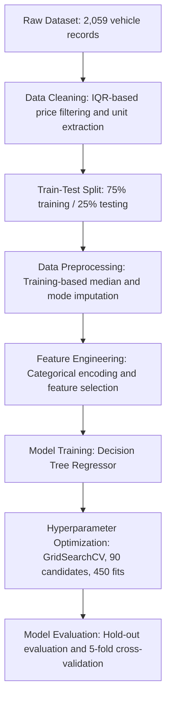

# Vehicle Price Prediction


## Project Overview

A machine learning regression project for predicting used vehicle prices based on technical specifications and vehicle characteristics, with a focus on data preprocessing, feature engineering, decision tree regression, and hyperparameter optimization.

## Dataset

| Attribute | Value |
|---|---:|
| Raw records | 2,059 |
| Filtered records | 1,844 |
| Raw columns | 20 |

The dataset contains vehicle specifications, manufacturing year, mileage, fuel type, transmission, engine capacity, power, torque, and price.

## Machine Learning Workflow



## Model Performance

| Evaluation | R² |
|---|---:|
| Baseline Decision Tree | 0.8027 |
| Tuned Decision Tree | 0.8623 |
| 5-Fold Cross-Validation (mean) | 0.8746 |

| Metric | Baseline | Tuned model |
|---|---:|---:|
| R² | 0.8027 | 0.8623 |
| MSE | 0.1134 | 0.0791 |
| MAE | 0.2387 | 0.1989 |

Reported scores are on the log-transformed price target, not the original currency scale. The cross-validation result is exploratory and should not be interpreted as an independent estimate of generalization performance.

## Hyperparameter Optimization

| Parameter | Search space |
|---|---|
| max_depth | None, 5, 8, 12, 15 |
| min_samples_split | 2, 10, 20 |
| min_samples_leaf | 1, 5, 10 |
| max_features | None, sqrt |
| CV folds | 5 |
| Total fits | 450 |

## Technologies

- Python
- Pandas & NumPy
- Scikit-learn
- Matplotlib & Seaborn
- GridSearchCV
- Joblib
- Jupyter Notebook

## Repository Structure

```text
vehicle-price-prediction/
├── Vehicles Price Predict/
│   ├── Data/
│   │   ├── Raw/
│   │   │   └── car details v4.csv
│   │   └── Processed/
│   │       └── processed_vehicles_data.csv
│   ├── Model/
│   │   └── vehicles_price_predict_model.pkl
│   ├── Notebooks/
│   │   └── VehiclesDecisionTrees.ipynb
│   └── requirements.txt
└── README.md
```

## Getting Started

```bash
git clone https://github.com/blgmstf332/vehicle-price-prediction.git
cd vehicle-price-prediction
pip install pandas numpy scikit-learn matplotlib seaborn joblib jupyter
jupyter notebook
```

Open `VehiclesDecisionTrees.ipynb` and update the dataset path to `../Data/Raw/car details v4.csv` when running from the notebook directory.

## Limitations & Future Improvements

- Integrate preprocessing and model training into a unified pipeline.
- Perform data-dependent preprocessing within cross-validation folds.
- Simplify target transformation.
- Report evaluation metrics on the original price scale.
- Correct model serialization and dependency management.
- Compare Decision Tree with ensemble regression algorithms.

## Author

**Mustafa Kılıç**

Computer Engineering Student — Artificial Intelligence, Machine Learning & Data Science

[GitHub](https://github.com/blgmstf332)
